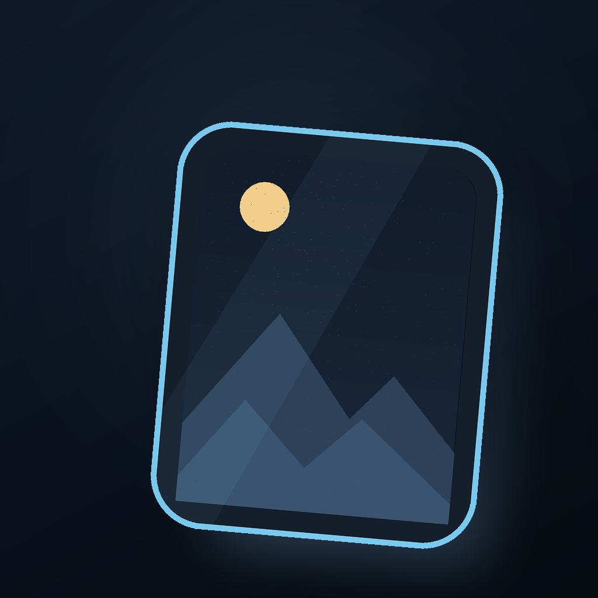

# 纹粒 / Texel（LingXiStyle）

公开品牌：简体中文「纹粒」，繁体中文 / 英文 / 日文「Texel」；仓库、Bundle ID 与 StoreKit Product ID 仍沿用 LingXiStyle。

给 iPhone 16 / 17 系列 HEIC 原片追加纹理与颗粒（Texture / Grain），另存为一张新的 HEIC。
原图不会被覆盖、不会被转码，照片不离开设备。



> [!IMPORTANT]
> 纹粒 / Texel 正在准备 App Store 正式发布。目前公开完整源码，正式商店版本将在完成审核后提供。
>
> 当前尚未在 App Store 上架，也不提供 TestFlight、预编译 IPA 或侧载包。你可以用 macOS、Xcode 和自己的 Apple ID 从源码构建；免费 Personal Team 签名 7 天过期，到期重新编译安装即可，相册里的照片不会丢。

## 状态

- **1.7.1（build 9）**：发布验证补强。新增真实 HEIC 端到端集成测试（真实 `ConversionService`、PhotoKit 保存回读、额度扣减与持久化）、分享扩展 12 条异常 / 取消 / 超时 / 重试状态机测试、快捷指令 9 条批量与额度测试，以及 1 条 XCUITest 启动 / 首页 / 设置 / Pro 入口冒烟；CI 增加集成测试与启动冒烟步骤，并预授权模拟器相册权限。1.7.0 的 CI 编译修复、分享扩展阻塞修复、共享 Keychain 组与免费 Offer Code 测试保持不变。
- **1.7.0（build 8）**：发布候选收口。修复 CI 在 Xcode 16.4 / iOS 18.5 SDK 上的编译失败（`StoreKitError` 新 case 的显式匹配，以及 `PeopleDetection` / `RasterImport` 与 Core 测试 fixture 的复杂表达式都改为旧编译器可处理的形式）；CI 拆成 iOS 18.5 与 iOS 26.0 两条构建 + 测试矩阵；修掉分享扩展读取完成后不进入处理流程的阻塞缺陷，并补 3 秒数据回退与 15 秒超时；模拟器签名构建实际走共享 Keychain Access Group；新增 100% 免费 Offer Code 的 StoreKit 自动化测试。
- 免费用户每天可成功转换 5 张 HEIC；失败、跳过、不兼容不扣额度。额度按本地自然日重置，App、分享扩展与快捷指令共用同一账本。
- Pro 是 StoreKit 2 非消耗型内购，Product ID `com.lingxifox.LingXiStyle.pro`（显示名「纹粒 Pro」/「Texel Pro」）；一次性购买、永久无限，可恢复购买，退款 / 撤销后回到免费额度。
- 本地化使用 String Catalog，支持简体中文、繁体中文、英文、日文；内部 Bundle ID、Keychain 服务名与 StoreKit Product ID 保持不变，升级不丢购买。
- 自动化测试：本机 `LingXiKitTests` 28/28、`LingXiPurchaseTests` 24/24（14 个 StoreKit + 10 个 Keychain）、`LingXiEngineTests` 2/2、`StylePortCoreTests` 14（2 个依赖外部 fixture，默认跳过）、`LingXiIntegrationTests` 29/29（8 真实转换 / PhotoKit、12 分享扩展、9 快捷指令）、`LingXiUITests` 1/1 启动冒烟。合计执行 98 项，96 项通过，2 项跳过。1.7.1 的 [run 42378432683](https://github.com/LingXiFox/LingXiStyle/actions/runs/42378432683) 全绿（commit `b5e2ace`：Policy、macOS 单测、iOS 18.5、iOS 26.x 四个 job 全部 success）；1.7.0 的 [run 42371186297](https://github.com/LingXiFox/LingXiStyle/actions/runs/42371186297) 也曾全绿。
- `generic/platform=iOS` 的 Debug 与 Release 构建均通过，0 error、0 Swift 源码 warning；签名 Debug 构建与模拟器签名构建通过。
- 真实样张：8064×6048 的 48MP HEIC，54 个主图 tile、15 个 HDR tile；1.2 在 iPhone 17 模拟器（iOS 27.3）完成从选图到保存回读的端到端转换，11/11 项无损校验通过；1.3 沿用同一引擎并在模拟器保存成功。
- 1.7 在同一台 iPhone 17（iOS 27.3）完成分享扩展端到端：从「照片」分享 5,924,047 字节原片，读入、转换、另存成功，额度从 4 / 5 变为 3 / 5；分享已处理过的照片会提示「无需重复处理」且不扣额度。签名模拟器构建的 App 与扩展均生成同一 Keychain Access Group（`$(AppIdentifierPrefix)com.lingxifox.LingXiStyle.shared`）。
- 兼容性验证边界：本机只有 iOS 27.3 运行时，已完成安装、启动、首页、设置、Pro、相册导入与真实 HEIC 转换；1.7.1 起 CI 在 iOS 18.5 与 iOS 26.0 上新增集成测试和启动冒烟，但完整 UI 主流程与真机仍未验证；iOS 18.0 只有编译目标，没有运行时证据。详见 [TEST_REPORT.md](TEST_REPORT.md)。

## 它做什么

- 从系统「照片」选择 HEIC 原片，或从「文件」导入 `.heic` / `.heif`。
- 用 PhotoKit 取出**原始资源文件**（iCloud 原件会真实下载），只追加纹理与颗粒。
- 输出编码后的主图 payload 逐 item 逐块比对 SHA-256；HDR、EXIF、Styles、缩略图保留。
- 用 `PHAssetCreationRequest` 另存为相册中的**新照片**，保存后回读确认仍是 HEIC。
- 提供真实的阶段进度、可取消队列、成功 / 跳过 / 失败统计、本地化错误与诊断信息。
- 准备阶段最多并发 2 张，单张 iCloud 照片不会阻塞整个队列；下载进度来自 PhotoKit 的真实回调。
- 转换任务按会话隔离：取消、重试、清空只影响所属批次，已保存照片不会被再次写入。
- 结果页可在 App 内查看已保存照片，并分享转换后的真实 HEIC；不依赖未公开的系统跳转。
- 免费额度 5 张 / 本地自然日，所有入口共享；转换成功并保存后才扣 1 张。
- 一次性购买「纹粒 Pro」/「Texel Pro」后无限张数；价格来自 `Product.displayPrice`，按当前 App Store 地区显示。
- 额度耗尽时提供「了解纹粒 Pro」与「明天再来」；批量超出时只处理剩余额度，不静默弹付费墙。
- 首次额度用尽时展示一次 Pro 介绍；之后只显示安静的额度页，不重复弹付费墙。
- 首页右上角设置可切换应用语言、查看 Pro 状态与恢复购买；语言切换写入系统 AppleLanguages，重启 App 后生效。

## 它不做什么

- 不覆盖原图，不修改原 Asset，不写回原文件。
- 不做 Live Photo 视频、ProRAW、JPEG → HEIC 转码、云端上传。
- 不伪造百分比、不生成虚假的前后对比、不用动画掩盖失败。
- 不伪造价格、不硬编码美元 / 人民币 / 日元 / 欧元，不把本地 `.storekit` 价格当成线上价格。
- 不使用私有框架；不依赖 App Group。免费额度默认使用共享 Keychain 槽位账本。
- 不发布 IPA 或侧载安装包；真实内购需要 App Store 发布环境，仓库只提供源码与本地 StoreKit 测试配置。

## 环境

| 项 | 版本 / 值 |
| --- | --- |
| 开发环境 | macOS + Xcode 16 或更高（作者使用 Xcode 27.3） |
| 部署目标 | iOS 18.0+ |
| 内购 | StoreKit 2；本地 `Configuration.storekit`，真实商品需 App Store Connect |
| 目标设备 | iPhone 16 / 17 系列 HEIC；其他 HEIC 需自行验证 |
| 工程生成 | [XcodeGen](https://github.com/yonaskolb/XcodeGen) 2.46 |
| 签名 | 你自己的 Apple Development Team；仓库不含 Team ID |
| 第三方依赖 | 仅 Apple 系统框架；无第三方 UI 框架 |

## 快速开始

需要 macOS、Xcode 16+、XcodeGen 2.46+。

```bash
git clone https://github.com/LingXiFox/LingXiStyle.git
cd LingXiStyle
brew install xcodegen
xcodegen generate
open LingXiStyle.xcodeproj
```

在 Xcode 的 Signing & Capabilities 里为 `LingXiStyle` **和 `LingXiStyleShare`** 选择自己的 Team。
如果 Bundle ID 冲突，把 `project.yml` 中的 `com.lingxifox` 全部替换成自己的前缀，再执行
`xcodegen generate`。

连接 iPhone，选择 `LingXiStyle` scheme，Run。首次启动前在
「设置 → 通用 → VPN 与设备管理」信任你的开发证书。主 App 跑通后，再测试随 App 一起安装的分享扩展。

命令行构建：

```bash
xcodebuild -project LingXiStyle.xcodeproj \
  -scheme LingXiStyle \
  -destination 'generic/platform=iOS' \
  DEVELOPMENT_TEAM=YOUR_TEAM_ID \
  -allowProvisioningUpdates build
```

跑测试：

```bash
xcodebuild -project LingXiStyle.xcodeproj -scheme LingXiKitTests \
  -destination 'platform=macOS,arch=arm64' test
xcodebuild -project LingXiStyle.xcodeproj -scheme LingXiEngineTests \
  -destination 'platform=macOS,arch=arm64' test
xcodebuild -project LingXiStyle.xcodeproj -scheme StylePortCoreTests \
  -destination 'platform=macOS,arch=arm64' test
xcodebuild -project LingXiStyle.xcodeproj -scheme LingXiPurchaseTests \
  -configuration Debug -destination 'platform=iOS Simulator,name=iPhone 17' test
xcodebuild -project LingXiStyle.xcodeproj -scheme LingXiIntegrationTests \
  -configuration Debug -destination 'platform=iOS Simulator,name=iPhone 17' test
xcodebuild -project LingXiStyle.xcodeproj -scheme LingXiUITests \
  -configuration Debug -destination 'platform=iOS Simulator,name=iPhone 17' test
```

`LingXiIntegrationTests` 使用仓库内的 48MP HEIC fixture，真实调用 `ConversionService`、PhotoKit
保存与 Keychain 额度账本；运行前需要给宿主 App 授权相册：
`xcrun simctl privacy booted grant photos com.lingxifox.LingXiStyle.IntegrationHost` 与
`xcrun simctl privacy booted grant photos-add ...`。`LingXiUITests` 只验证安装、启动、首页、
设置与 Pro 入口，不伪造转换结果。

`LingXiPurchaseTests` 是 iPhone Simulator 上由最小宿主 App 承载的单元测试：
`SKTestSession` 必须在任何 StoreKit 客户端之前初始化，因此宿主刻意不创建 `AppModel`。
它覆盖 StoreKit 2 购买 / 恢复 / 退款与 Keychain 额度；Quota 的 SQLite 测试仍在 macOS
`LingXiKitTests` 中。

## 分发方式

这个仓库只提供源码。原因很实际：

1. 目标设备和系统矩阵很窄，HEIC 的 `iref` / grid / tile 结构会随机型和系统版本变化，尚未做完整验证。
2. 预编译 IPA 无法用不同人的签名复用；免费证书 7 天过期，最适合的方式就是自己从源码编译。
3. 分享扩展、快捷指令与系统权限矩阵仍处于真机验证阶段，尚不适合作为预编译包分发。

因此仓库不发布 IPA，也不提供 AltStore / 侧载支持。

## 架构

```
App (SwiftUI)                     ShareExtension (SwiftUI in UIKit host)
        \                              /
         \                            /
          LingXiServices  ← 唯一的 ConversionService
                |
          LingXiEngine  (URL → URL，固定管线)
           /        \
      LingXiKit   StylePortCore (vendor，纹理与颗粒编码核心)
```

| 层 | 位置 | 职责 |
| --- | --- | --- |
| App | `App/Sources` | 四态 UI、DesignSystem、AppModel、快捷指令、Pro / 额度页面 |
| Services | `Services/Sources/LingXiServices` | PhotoKit 适配 + 唯一转换入口 + 额度预约 / 提交，App 与扩展共用同一份二进制 |
| Engine | `Engine/Sources/LingXiEngine` | 读文件 → 检查 → 调核心 → 复审 → 写临时文件 |
| Kit | `Kit/Sources/LingXiKit` | ISO BMFF / HEIF 解析、兼容性判定、无损校验、任务状态机、额度、StoreKit 权益、诊断 |
| Core | `Core/Sources/StylePortCore` | 上游纹理与颗粒编码核心（MIT，见 ThirdPartyNotices） |

所有入口（图库、文件导入、快捷指令、分享扩展）最终都调用
`ConversionService.shared.convert(_:onStage:)`。PhotoKit 与分享面板只是输入 / 输出适配器，
不参与编码决策。

`Kit/Sources/LingXiKit/ConversionRun.swift` 是任务会话状态机：记录每张照片的
`pending / saved / skipped / failed / cancelled` 状态，只有所属 session token 能推进队列；
已保存项不会被重试，取消后的未开始项按顺序标记为取消。

### 固定管线

1. `ConversionService` 读取 StoreKit 权益并预留 1 个免费额度；已有 Pro 权益时直接跳过预留。
2. `PHAssetResourceManager.writeData` 导出原始资源文件（`isNetworkAccessAllowed = true`）。
3. `HEICInspector` 解析 `ftyp / meta / iinf / iref / iprp / iloc`，判断 grid、tile、HDR、Styles、EXIF、缩略图。
4. `CompatibilityEvaluator` 给出 `ready / alreadyEnhanced / unsupported`，UI 只显示真实结论。
5. `StylePorter.patch` 只追加 Texture / Grain（`analyzePhoto = false`，其余效果关闭）。
6. 重新解析输出，`IntegrityVerifier` 对主图 payload 逐 item 分块 SHA-256 比对，并检查 HDR、EXIF、Styles、缩略图、Gain Map。
7. `PHAssetCreationRequest.addResource(with: .photo, fileURL:)` 另存新 Asset，`originalFilename` 形如 `IMG_1234_TextureGrain.HEIC`。
8. 回读新 Asset 的资源类型，确认仍是 HEIC 才报告成功，然后提交额度；任何失败路径释放预留。

### 无损的定义

- 主图编码 payload：逐 item、逐 tile、排序后分块 SHA-256 完全一致。
- HDR 层、EXIF、Styles / Texture Styles、缩略图、Gain Map 均保留。
- 因为容器里新增了纹理与元数据，整个文件的 SHA-256 必然不同；UI 与诊断不会把它说成「文件完全一致」。

## 兼容性

| 输入 | 结果 |
| --- | --- |
| iPhone 16 / 17 HEIC 原片（含 grid + 多 tile） | 可添加 |
| 已带纹理与颗粒 | 无需处理 |
| Live Photo | 暂不支持，跳过并提示；不会处理视频部分 |
| RAW / RAW+HEIC | 暂不支持 |
| JPEG / PNG / TIFF / DNG | 拒绝，并给出本地化原因 |
| 已在系统相册编辑过的 Asset | 提示会基于当前原件另存新照片，不覆盖 |
| 损坏 / 缺主图 / 缺 Styles | 拒绝，诊断里保留原始错误码 |

## 四个页面与设置

1. **首页**：左侧额度胶囊、右侧 44pt 设置按钮、64pt 品牌标记、两行标题、三行 inset grouped 说明、橙色「选择照片」与「从「文件」导入」、底部「最多 9 张 · HEIC / HEIF」。
2. **已选照片**：392pt 大图不裁切、68pt 缩略图条、材质兼容标签、48MP 信息条、可添加 / 跳过汇总、额度 footnote 与主 CTA。
3. **处理中**：4pt 确定性进度条、300pt 清晰预览、真实阶段列表与 X/Y、可取消队列；不使用扫光、呼吸光或渐变边框。
4. **结果页**：已保存照片预览、成功 / 跳过 / 失败统计、应用内查看与分享、单条诊断入口、继续处理与失败重试；原始错误码只放诊断。

设置页使用原生 Form：Pro 状态与恢复购买、跟随系统 / 简体中文 / 繁体中文 / English / 日本語、隐私说明与第三方许可。Pro 页、额度耗尽页与权限页均为独立 sheet / 页面，支持深色、浅色与 Dynamic Type。

支持真深 / 浅色、Dynamic Type、横竖屏、窄屏、VoiceOver 与 Reduce Motion
（关闭循环动效，只保留状态变化）。设计令牌见
`App/Sources/DesignSystem/Tokens.swift`，动效见 `Motion.swift`。

## 任务生命周期与取消

- 每次开始转换都会创建独立的 `ConversionRun` 会话；阶段、结果与完成回调只更新所属会话，
  旧任务不能覆盖新一轮 UI。
- `reset()` 只会 retire 当前工作目录；等正在进行的准备 / 转换操作结束后才删除临时文件，
  不会抽走任务正在读取的文件。
- 取消时，当前照片会走到安全边界：已经写入相册的照片保留并计入成功，尚未开始的照片标记为取消，
  不会继续调用转换。
- 重试只重置失败项；已保存项永久跳过，避免重复保存。只有权限与工作区都就绪后才清空
  失败状态，启动被拒绝时结果页仍保留原失败项。保存已写入但回读确认失败时，结果会记录
  警告而不是把该照片判为失败，从而避免重试重复写入。
- 准备队列与转换任务分离；关闭选择、清空或重新选片会取消准备任务，而不是让 iCloud 下载在后台空转。

## 免费额度与纹粒 Pro

### 免费额度

- 每天 5 张，按设备本地自然日重置；`QuotaConfiguration.freeDailyLimit` 是唯一配置点，Pro 页与额度文案都从这里插值。
- 只有**转换成功并完成保存 / 导出**才扣 1 张；兼容性检查失败、已带质感、Live Photo、RAW、
  编码失败、无损校验失败、取消或保存失败都会释放预留，不扣额度。
- App、分享扩展、快捷指令都调用同一个 `ConversionService`；额度检查、预留、提交、释放都在
  这个共享服务里完成，入口无法绕过。
- 批量选择超过剩余额度时，App 只处理剩余张数，其余保留为未处理并显示数量，同时提示升级 Pro 或明天继续；
  不会在转换中途静默弹出付费墙。
- 额度耗尽时显示「今日免费额度已用完」，可选择「了解纹粒 Pro」或「明天再来」；首次触及上限时只主动展示一次 Pro 介绍。

### 额度存储

默认使用 `KeychainQuotaStore`：每个本地日有 0..<5 个槽位，账号形如
`slot.<yyyy-MM-dd>.<index>`。预留用 `SecItemAdd` 的唯一性做原子占位，两个进程同时抢最后一个
槽位时只有一个成功；提交把标记从 `reserved` 改为 `committed`，释放只删除自己创建的
`reserved` 槽位。30 分钟未提交的预留会被回收，跨天自动从新槽位开始。

- App 与分享扩展共享 Keychain Access Group
  `$(AppIdentifierPrefix)com.lingxifox.LingXiStyle.shared`，不依赖 App Group。
- 使用 Xcode 自动签名构建的模拟器产物会生成 `Simulated.xcent`，其中包含同一共享组；
  1.7 已用该构建验证扩展转换后主 App 额度同步减少。手动 `codesign --deep` 会抹掉模拟授权，
  不要用它重签 QA 包。真机 distribution 签名下的共享组仍需在真机复验。
- `QuotaManager` 仍保留 SQLite 实现，供单元测试与未来显式注入 App Group 容器使用；生产默认
  不会走 App Group 分支。

### Pro 购买

- StoreKit 2，非消耗型：`com.lingxifox.LingXiStyle.pro`。
- 商品加载失败时 Pro 页面显示本地化错误与「重试」，不显示任何假价格；成功后只使用
  `Product.displayPrice`。
- 购买结果必须经过 `VerificationResult<Transaction>` 验证，并再次读取
  `Transaction.currentEntitlements(for:)` 才把 `isPro` 置为 true；本地布尔值、按钮回调或
  未验证交易都不能解锁。
- 支持恢复购买、未完成交易、交易监听、待批准、取消、失败、退款 / 撤销；退款后
  `isPro` 变为 false，免费额度重新生效。
- 本地测试配置在仓库根目录 `Configuration.storekit`，只在 Debug scheme 生效；
  Release 构建不包含可购买测试商品。真实商品配置见 [AppStoreRelease.md](AppStoreRelease.md)。

## 快捷指令

「添加纹理与颗粒」接受 1–N 个文件，参数：

- 保存到相册（默认开）
- 返回转换后的文件（默认关）
- 仅检查兼容性（默认关）

输出转换后的文件列表（仅在打开「返回转换后的文件」时），并用「已转换 / 已存入相册 /
跳过 / 失败」分项统计。输入会先复制到 App 沙盒，再交给 `ConversionService`，不会碰原文件；
返回的 `IntentFile` 在临时目录被清理前已读入内存，避免文件生命周期竞态。

## 分享扩展

在系统「照片」里分享一张 HEIC 到「纹粒」（英文 / 日文 / 繁体界面为「Texel」）：

1. `loadFileRepresentation` 后**立刻**复制到扩展自己的沙盒（回调外 URL 会失效）。
2. 3 秒内没有文件回调时并行尝试 `loadDataRepresentation`；15 秒仍无完整文件则报
   `E_SHARE_READ_TIMEOUT`，不会无限停在读取页。
3. 强制解析并校验完整 HEIC；不是 HEIC 就提示回主 App 从图库选择。
4. 通过后调用同一个 `ConversionService` 保存新照片。处理中只提供「取消」，成功后才显示「完成」；
   失败或取消可安全重试，临时文件在关闭时清理。

1.7 修复了读取成功后不进入处理的缺陷：原判断把当前 `reading` 阶段也算作忙碌，
导致回调已复制完文件却被静默丢弃。现在只阻止重复处理任务，并记录读取字节数。

自动化测试覆盖 100% 免费 Offer Code：本机 iOS 27.3 的 StoreKitTest 中
`DEVELOPER_FREE` 兑换后交易价格为 0，仍通过验签并授予 Pro；这证明授权逻辑不依赖价格。
iOS 18 的旧 SDK 没有 `.codeOffer` API，iOS 26 的 StoreKitTest 会忽略本地 Offer Code，
因此这两条 CI 分别编译期排除 / 运行期跳过，不能当成生产兑换已验收。生产环境必须只通过
App Store Connect 官方 Offer Code 发放。

分享面板有时只给 JPEG / 预览图，这时会被拒绝，这是预期行为——转码会破坏原始编码。

## 错误码

| 码 | 含义 |
| --- | --- |
| `E_UNREADABLE` | 文件不可读 |
| `E_CORRUPT` | HEIF 结构无法解析 |
| `E_UNSUPPORTED:<issues>` | 兼容性判定拒绝，issues 为具体项 |
| `E_ALREADY_TEXTURED` | 已带纹理与颗粒 |
| `E_ENGINE` | 核心编码错误 |
| `E_VERIFY:<checks>` | 无损校验失败 |
| `E_WRITE` | 临时文件写入失败 |
| `E_PHOTO_NO_HEIC` | 该 Asset 没有 HEIC 照片资源 |
| `E_PHOTO_EXPORT` | 原件导出失败 |
| `E_PHOTO_SAVE` | 相册写入失败 |
| `E_PHOTO_ADD_DENIED` | 没有相册写入权限，需在系统设置中允许添加照片 |
| `E_PHOTO_SAVED_MISSING` | 保存后找不到新 Asset |
| `E_PHOTO_SAVED_NOT_HEIC` | 保存后回读不是 HEIC |
| `E_QUOTA_EXHAUSTED` | 今日免费额度已用完；可明天继续或升级 Pro |
| `E_QUOTA_UNAVAILABLE` | 额度服务不可用（Keychain / 数据库无法读取） |
| `E_QUOTA_STORE` | 额度存储读写失败 |

诊断页会附上文件结构、item 布局、校验结果与脱敏后的系统信息；原始码只出现在诊断里，
主界面只显示本地化解释。

## 目录

```
App/Sources/            Views / Components / DesignSystem / Models / Integrations / AppModel.swift
Services/Sources/       LingXiServices（PhotoKit 适配 + ConversionService）
Engine/Sources/         LingXiEngine
Kit/Sources/            LingXiKit（含 ConversionRun 任务会话状态机）
Core/Sources/           StylePortCore（vendor）
Core/Resources/Profiles 45-15 / 48-12 / live-photo-video
Kit/Tests/              ISOBox / 兼容性 / 校验 / ConversionRun / Quota 测试
Engine/Tests/           引擎集成测试
Tests/LingXiPurchaseTests/  StoreKit 2 + Keychain 额度测试（Simulator）
Tests/LingXiIntegrationTests/ 真实 HEIC / PhotoKit / 分享扩展 / 快捷指令集成测试
Tests/LingXiUITests/   安装、启动、首页、设置与 Pro 入口冒烟
Tests/Fixtures/        48MP 真实 HEIC 测试样张与来源说明
Tests/IntegrationHost/ 仅用于承载集成测试的最小 App
Tests/PurchaseHost/     仅用于承载 StoreKit 测试的最小 App
ShareExtension/         分享扩展
Configuration.storekit  本地 StoreKit 测试商品（非线上价格）
AppStoreRelease.md      App Store Connect / 真实内购发布清单
Resources/Localization/ String Catalog（zh-Hans / zh-Hant / en / ja）
.github/workflows/      CI：双 SDK 构建 + 测试矩阵
.github/actions/setup/   CI 复用 action
ThirdPartyNotices/      上游 MIT 许可证与 vendor 说明
project.yml             XcodeGen 工程定义
```

## 已知限制

- 1.7.1 本机已完成 Debug / Release generic iOS 构建与六套自动化测试（Kit 28 / Purchase 24 / Engine 2 / Core 14 执行、2 跳过 / Integration 29 / UI 1），合计 98 项执行、96 项通过、2 项跳过。集成测试真实读取 48MP HEIC、转换、PhotoKit 保存回读并扣减 Keychain 额度；分享扩展状态机覆盖取消、无文件、3 秒回退、15 秒超时、重试、损坏 / 已处理 / 额度耗尽；快捷指令覆盖单张、同名多张、仅检查、仅保存、额度耗尽与 Pro。
- 真机安装、真实 App Store 交易、iOS 18.0 / 26.1 / 26.2 / 27.0–27.2 运行时、权限拒绝页、快捷指令 UI、Duo 的选片 / 转换 / 结果页仍未验证。模拟器签名构建能证明材料中的共享组配置，但不能替代真机 distribution 签名。详见 [TEST_REPORT.md](TEST_REPORT.md)。
- 免费 Personal Team 只能使用本地 StoreKit 配置测试；真实内购与上架需要付费 Apple Developer Program、App Store Connect 商品与 Sandbox / 生产环境。
- `Configuration.storekit` 的 `$2.99` 只是本地测试价；线上价格由 App Store Connect 与 `Product.displayPrice` 决定。
- 不同机型 / iOS 版本的 HEIC 可能使用不同的 `iref` 结构；已加 16-bit / 32-bit 回归测试，但仍需更多样本。
- 分享扩展首次运行时可能拿不到相册写入授权（扩展内不一定能弹权限框）。此时会提示先回 App 授权；这是系统行为，需真机确认具体表现。
- 分享面板可能把照片转成 JPEG，扩展会拒绝而不是偷偷转码。
- Live Photo 暂不支持，会跳过并提示；视频部分不会被处理。
- 免费 Personal Team 签名 7 天过期。

## 隐私

- App 本身不发起网络请求，不上传照片，不收集分析数据。
- iCloud 原件下载由 PhotoKit 在系统层完成。
- 导出与转换的临时文件位于沙盒 `tmp`；`SessionWorkspace` 用引用计数延迟删除，任务结束或清空后清理。
  成功保存的照片由系统相册管理；结果页分享使用所属会话的输出文件，继续处理时一并释放。

## 第三方与许可

- 本项目：[MIT License](LICENSE)，Copyright (c) 2026 LingXiFox。
- 风格核心：[Shalielie](https://github.com/nathanatgit/Shalielie)，MIT License，Copyright (c) 2026 nathanatgit；全文见 [ThirdPartyNotices/Shalielie-LICENSE.txt](ThirdPartyNotices/Shalielie-LICENSE.txt)，vendor 范围见 [ThirdPartyNotices/README.md](ThirdPartyNotices/README.md)。
- 界面只使用 SF Symbols、系统字体与原生材质；SF Symbols 不随本仓库分发。
- Apple、iPhone、PhotoKit 等是 Apple Inc. 的商标。本项目与 Apple 无关联。

## 文档

- [TEST_REPORT.md](TEST_REPORT.md)：构建、测试、模拟器 / 真机验证与未覆盖矩阵。
- [AppStoreRelease.md](AppStoreRelease.md)：App Store Connect、商品、地区定价、Sandbox 与发布清单。
- [AGENTS.md](AGENTS.md)：给在本仓库工作的编码代理的约束。
